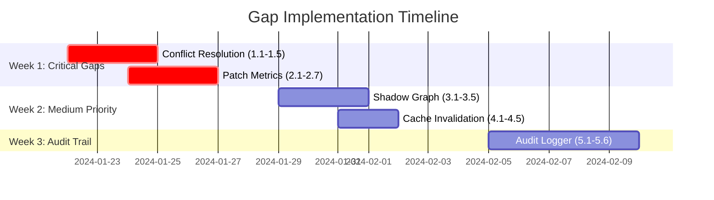

# Self-Healing Architecture Gaps - Implementation Plan

**Document Version**: 1.0  
**Created**: 2024-01-15  
**Status**: 🚧 In Planning  
**Parent Document**: DETAILED_SELF_HEALING_OPTIONS_1_TO_5_ARCHITECTURE_PLAN.md v2.0  
**Audit Report**: ../04-Audits-and-Compliance/SELF_HEALING_ARCHITECTURE_IMPLEMENTATION_AUDIT.md

---

## Overview

This document provides **actionable implementation tasks** to close the 4 identified gaps in the self-healing architecture. Tasks are organized by priority and include file locations, code snippets, and test requirements.

**Gap Summary**:
- 🔴 **HIGH**: Conflict Resolution, Patch-Specific Metrics
- 🟡 **MEDIUM**: Shadow Graph Overlay, Cache Invalidation, Audit Trail

---

## 🔴 GAP 1: Conflict Resolution (HIGH PRIORITY)

### Problem Statement
Currently, when two patches target the same `(entity_id, attribute)` pair, the system uses **last-write-wins** (Redis key overwrite). This can silently discard valid corrections and create data inconsistency.

### Architecture Requirement (Section 7)
- Detect conflicts when `add_correction()` is called with existing patch for same entity+attribute
- Apply precedence rules:
  1. Regulatory source > User feedback
  2. Higher confidence wins (if delta >= 0.15)
  3. Escalate to human if confidence delta < 0.10
- Track patch lineage via versioning fields

---

### Task 1.1: Add Patch Versioning Fields

**File**: `backend/app/graph/correction_patch_layer.py`  
**Estimated Time**: 30 minutes

**Changes to CorrectionPatch dataclass**:
```python
@dataclass
class CorrectionPatch:
    patch_id: str
    entity_id: str
    attribute: str
    canonical_value: Any
    corrected_value: Any
    confidence: float
    provenance: Dict[str, Any]
    approved: bool
    created_at: str
    expires_at: Optional[str] = None
    
    # NEW FIELDS for conflict resolution
    version: int = 1  # Monotonic version counter
    supersedes_patch_id: Optional[str] = None  # Tracks patch lineage
    superseded_by_patch_id: Optional[str] = None  # Bidirectional link
    conflict_resolution_reason: Optional[str] = None  # Audit trail for auto-resolution
    source_type: str = "user_feedback"  # "user_feedback" or "regulatory"
```

**Migration**: Existing patches in Redis will default to version=1, source_type="user_feedback"

---

### Task 1.2: Implement PatchConflictResolver

**New File**: `packages/amc-repair-engine/src/amc_repair/conflict_resolver.py`  
**Estimated Time**: 3 hours

```python
"""
amc_repair.conflict_resolver
=============================
Detects and resolves conflicting patches using precedence rules.
"""

import logging
from dataclasses import dataclass
from typing import List, Optional

logger = logging.getLogger("amc_repair.conflict_resolver")


@dataclass
class ConflictReport:
    """Details of a patch conflict."""
    conflict_type: str  # "attribute_collision", "value_divergence", "cascade_conflict"
    existing_patches: List[dict]
    new_patch: dict
    resolution_strategy: str  # "auto_supersede", "escalate_to_human", "confidence_based_supersede"
    confidence_delta: float
    recommended_action: str  # Human-readable explanation


class PatchConflictResolver:
    """Handles conflicting patches using version vectors and precedence rules."""
    
    CONFIDENCE_AUTO_RESOLVE_THRESHOLD = 0.15  # Auto-resolve if delta >= 0.15
    CONFIDENCE_HUMAN_ESCALATION_THRESHOLD = 0.10  # Escalate if delta < 0.10
    
    async def detect_conflict(
        self, 
        patch_layer: Any,
        new_patch: dict
    ) -> Optional[ConflictReport]:
        """
        Check if new patch conflicts with existing patches.
        
        Returns ConflictReport if conflict detected, else None.
        """
        entity_id = new_patch.get("entity_id")
        attribute = new_patch.get("attribute")
        
        # Query existing patches for this entity+attribute
        existing = await self._get_existing_patches(patch_layer, entity_id, attribute)
        
        if not existing:
            return None  # No conflict
        
        # Calculate confidence delta
        new_conf = float(new_patch.get("confidence", 1.0))
        existing_conf = max([float(p.get("confidence", 0.0)) for p in existing])
        confidence_delta = abs(new_conf - existing_conf)
        
        # Determine resolution strategy
        strategy = self._determine_strategy(existing, new_patch, confidence_delta)
        
        return ConflictReport(
            conflict_type="attribute_collision",
            existing_patches=existing,
            new_patch=new_patch,
            resolution_strategy=strategy,
            confidence_delta=confidence_delta,
            recommended_action=self._get_recommendation(strategy, existing, new_patch)
        )
    
    def _determine_strategy(
        self, 
        existing: List[dict], 
        new: dict, 
        conf_delta: float
    ) -> str:
        """
        Apply precedence rules to determine conflict resolution strategy.
        
        Precedence:
        1. Regulatory source beats user feedback
        2. Higher confidence wins if delta >= 0.15
        3. Escalate to human if delta < 0.10
        4. Most recent timestamp breaks ties
        """
        new_source = new.get("source_type", "user_feedback")
        existing_source = existing[0].get("source_type", "user_feedback")
        
        # Rule 1: Regulatory > User feedback
        if new_source == "regulatory" and existing_source == "user_feedback":
            return "auto_supersede"
        if new_source == "user_feedback" and existing_source == "regulatory":
            return "reject_new"
        
        # Rule 2: High confidence delta → confidence-based supersede
        if conf_delta >= self.CONFIDENCE_AUTO_RESOLVE_THRESHOLD:
            new_conf = float(new.get("confidence", 0.0))
            existing_conf = float(existing[0].get("confidence", 0.0))
            if new_conf > existing_conf:
                return "confidence_based_supersede"
            else:
                return "reject_new"
        
        # Rule 3: Low confidence delta → human escalation
        if conf_delta < self.CONFIDENCE_HUMAN_ESCALATION_THRESHOLD:
            return "escalate_to_human"
        
        # Rule 4: Medium delta → newer timestamp wins
        return "timestamp_based_supersede"
    
    def _get_recommendation(
        self, 
        strategy: str, 
        existing: List[dict], 
        new: dict
    ) -> str:
        """Generate human-readable recommendation."""
        if strategy == "auto_supersede":
            return f"Automatically supersede existing patch (regulatory source override)"
        elif strategy == "confidence_based_supersede":
            return f"Automatically supersede existing patch (confidence {new.get('confidence')} > {existing[0].get('confidence')})"
        elif strategy == "escalate_to_human":
            return f"Escalate to human review (confidence delta {abs(float(new.get('confidence', 0)) - float(existing[0].get('confidence', 0))):.2f} < 0.10)"
        elif strategy == "reject_new":
            return f"Reject new patch (existing has higher authority/confidence)"
        elif strategy == "timestamp_based_supersede":
            return f"Supersede based on recency (newer patch preferred)"
        return "Unknown resolution strategy"
    
    async def _get_existing_patches(
        self, 
        patch_layer: Any, 
        entity_id: str, 
        attribute: str
    ) -> List[dict]:
        """Query patch layer for existing patches."""
        patch = patch_layer.get_correction(entity_id, attribute)
        if patch:
            return [{
                "entity_id": patch.entity_id,
                "attribute": patch.attribute,
                "canonical_value": patch.canonical_value,
                "corrected_value": patch.corrected_value,
                "confidence": patch.confidence,
                "source_type": getattr(patch, "source_type", "user_feedback"),
                "created_at": patch.created_at,
            }]
        return []
    
    async def resolve_conflict(
        self,
        patch_layer: Any,
        conflict: ConflictReport
    ) -> dict:
        """
        Execute automatic conflict resolution.
        
        Returns resolution report dict.
        """
        strategy = conflict.resolution_strategy
        
        if strategy == "escalate_to_human":
            logger.warning(
                "Conflict requires human review: %s.%s (confidence delta %.2f < 0.10)",
                conflict.new_patch.get("entity_id"),
                conflict.new_patch.get("attribute"),
                conflict.confidence_delta
            )
            return {
                "resolution": "pending_human_review",
                "conflict_id": f"conflict_{conflict.new_patch.get('entity_id')}_{conflict.new_patch.get('attribute')}",
                "escalated": True
            }
        
        if strategy in ["auto_supersede", "confidence_based_supersede", "timestamp_based_supersede"]:
            # Supersede existing patch
            existing_patch = conflict.existing_patches[0]
            new_patch = conflict.new_patch
            
            # Update version and lineage
            new_version = existing_patch.get("version", 1) + 1
            new_patch["version"] = new_version
            new_patch["supersedes_patch_id"] = existing_patch.get("patch_id")
            new_patch["conflict_resolution_reason"] = conflict.recommended_action
            
            logger.info(
                "Auto-resolved conflict: %s.%s via %s (new version=%d)",
                new_patch.get("entity_id"),
                new_patch.get("attribute"),
                strategy,
                new_version
            )
            
            return {
                "resolution": "auto_resolved",
                "strategy": strategy,
                "superseded_patch_id": existing_patch.get("patch_id"),
                "new_version": new_version
            }
        
        # Reject new patch
        logger.info(
            "Rejected new patch for %s.%s (existing has higher authority)",
            conflict.new_patch.get("entity_id"),
            conflict.new_patch.get("attribute")
        )
        return {
            "resolution": "rejected",
            "reason": conflict.recommended_action
        }


def get_conflict_resolver() -> PatchConflictResolver:
    """Singleton accessor."""
    return PatchConflictResolver()
```

---

### Task 1.3: Integrate Conflict Detection into add_correction()

**File**: `backend/app/graph/correction_patch_layer.py`  
**Estimated Time**: 1 hour

**Modify add_correction() method** (around line 89):
```python
async def add_correction(
    self,
    entity_id: str,
    attribute: str,
    canonical_value: Any,
    corrected_value: Any,
    confidence: float,
    provenance: Optional[Dict[str, Any]] = None,
    approved: bool = False,
    source_type: str = "user_feedback",  # NEW PARAMETER
) -> dict:  # Changed return type from str to dict
    """
    Add or update a correction patch with conflict detection.
    
    Returns dict with keys: patch_id, conflict_detected, conflict_report
    """
    from amc_repair.conflict_resolver import get_conflict_resolver
    
    # Step 1: Detect conflicts
    conflict_resolver = get_conflict_resolver()
    new_patch_dict = {
        "entity_id": entity_id,
        "attribute": attribute,
        "canonical_value": canonical_value,
        "corrected_value": corrected_value,
        "confidence": confidence,
        "source_type": source_type,
        "provenance": provenance or {},
    }
    
    conflict = await conflict_resolver.detect_conflict(self, new_patch_dict)
    
    # Step 2: Resolve conflict (if detected)
    resolution = None
    version = 1
    supersedes_patch_id = None
    conflict_resolution_reason = None
    
    if conflict:
        resolution = await conflict_resolver.resolve_conflict(self, conflict)
        
        if resolution["resolution"] == "pending_human_review":
            # Don't create patch yet, escalate to governance queue
            logger.warning("Conflict escalated to human review: %s", resolution["conflict_id"])
            return {
                "patch_id": None,
                "conflict_detected": True,
                "conflict_report": conflict,
                "resolution": resolution,
                "status": "pending_human_review"
            }
        
        if resolution["resolution"] == "rejected":
            logger.info("New patch rejected due to conflict: %s", resolution["reason"])
            return {
                "patch_id": None,
                "conflict_detected": True,
                "conflict_report": conflict,
                "resolution": resolution,
                "status": "rejected"
            }
        
        # Auto-resolved: update versioning
        version = resolution.get("new_version", 1)
        supersedes_patch_id = resolution.get("superseded_patch_id")
        conflict_resolution_reason = conflict.recommended_action
    
    # Step 3: Create patch (existing logic with new fields)
    patch_id = f"patch_{uuid.uuid4().hex[:12]}"
    patch_key = self._make_key(entity_id, attribute)
    
    now = datetime.utcnow()
    expires_at = None if approved else (now + timedelta(days=self.ttl_days)).isoformat() + "Z"
    
    patch = CorrectionPatch(
        patch_id=patch_id,
        entity_id=entity_id.strip(),
        attribute=attribute.strip(),
        canonical_value=canonical_value,
        corrected_value=corrected_value,
        confidence=round(float(confidence), 3),
        provenance=provenance or {},
        approved=approved,
        created_at=now.isoformat() + "Z",
        expires_at=expires_at,
        version=version,
        supersedes_patch_id=supersedes_patch_id,
        superseded_by_patch_id=None,
        conflict_resolution_reason=conflict_resolution_reason,
        source_type=source_type,
    )
    
    # ... (rest of existing Redis write logic)
    
    return {
        "patch_id": patch_id,
        "conflict_detected": conflict is not None,
        "conflict_report": conflict,
        "resolution": resolution,
        "status": "created"
    }
```

---

### Task 1.4: Create Conflict Triage API Endpoints

**File**: `backend/app/api/routes/governance.py`  
**Estimated Time**: 2 hours

```python
from app.compliance.security import require_roles, Role

@governance_router.get(
    "/conflicts",
    summary="List patches pending human conflict resolution",
    tags=["governance", "conflicts"]
)
@require_roles([Role.COMPLIANCE_OFFICER, Role.ADMIN, Role.REVIEWER])
async def list_conflicts():
    """Retrieve all patches with status=pending_human_review."""
    # Implementation: query patch layer for patches with conflict_resolution_reason != None
    #   and approval status = pending
    pass


@governance_router.post(
    "/conflicts/{conflict_id}/resolve",
    summary="Manually resolve a patch conflict",
    tags=["governance", "conflicts"]
)
@require_roles([Role.COMPLIANCE_OFFICER, Role.ADMIN])
async def resolve_conflict(
    conflict_id: str,
    action: str,  # "select_winner", "merge", "reject_all"
    selected_patch_id: Optional[str] = None,
    merged_value: Optional[str] = None,
    reason: str = ""
):
    """
    Manual conflict resolution actions:
    - select_winner: Approve one patch, reject others
    - merge: Create new patch with merged value
    - reject_all: Reject all conflicting patches
    """
    pass
```

---

### Task 1.5: Add Tests

**New File**: `backend/tests/test_conflict_resolver.py`  
**Estimated Time**: 2 hours

```python
import pytest
from amc_repair.conflict_resolver import PatchConflictResolver, ConflictReport

async def test_regulatory_source_beats_user_feedback():
    """Regulatory patches auto-supersede user feedback patches."""
    resolver = PatchConflictResolver()
    
    existing = [{
        "entity_id": "Axis Bluechip Fund",
        "attribute": "CATEGORY",
        "corrected_value": "Large Cap",
        "confidence": 0.85,
        "source_type": "user_feedback"
    }]
    
    new = {
        "entity_id": "Axis Bluechip Fund",
        "attribute": "CATEGORY",
        "corrected_value": "Mid Cap",
        "confidence": 0.80,  # Lower confidence but regulatory source
        "source_type": "regulatory"
    }
    
    strategy = resolver._determine_strategy(existing, new, conf_delta=0.05)
    assert strategy == "auto_supersede"

async def test_high_confidence_delta_auto_resolves():
    """Confidence delta >= 0.15 triggers auto-resolution."""
    resolver = PatchConflictResolver()
    
    existing = [{
        "entity_id": "Test Fund",
        "attribute": "TER",
        "corrected_value": "1.5",
        "confidence": 0.70,
        "source_type": "user_feedback"
    }]
    
    new = {
        "entity_id": "Test Fund",
        "attribute": "TER",
        "corrected_value": "1.8",
        "confidence": 0.90,  # Delta = 0.20 >= 0.15
        "source_type": "user_feedback"
    }
    
    strategy = resolver._determine_strategy(existing, new, conf_delta=0.20)
    assert strategy == "confidence_based_supersede"

async def test_low_confidence_delta_escalates():
    """Confidence delta < 0.10 escalates to human review."""
    resolver = PatchConflictResolver()
    
    existing = [{
        "entity_id": "Test Fund",
        "attribute": "AUM",
        "corrected_value": "5000 Cr",
        "confidence": 0.83,
        "source_type": "user_feedback"
    }]
    
    new = {
        "entity_id": "Test Fund",
        "attribute": "AUM",
        "corrected_value": "5200 Cr",
        "confidence": 0.87,  # Delta = 0.04 < 0.10
        "source_type": "user_feedback"
    }
    
    strategy = resolver._determine_strategy(existing, new, conf_delta=0.04)
    assert strategy == "escalate_to_human"
```

**Success Criteria**:
- ✅ Precedence rules correctly applied
- ✅ Audit trail created (conflict_resolution_reason field populated)
- ✅ Integration test: add_correction() detects and resolves conflicts

---

## 🔴 GAP 2: Patch-Specific Metrics (HIGH PRIORITY)

### Problem Statement
The current monitoring module (`backend/app/monitoring/metrics.py`) lacks **patch-specific telemetry**, making it impossible to measure:
- Fast-path hit rate (target: >40%)
- Guardrail intervention rate (target: 2-5%)
- Shadow graph patch usage
- Promotion velocity

### Architecture Requirement (Section 6)
Implement `PatchMetricsCollector` class with methods to track each healing layer.

---

### Task 2.1: Implement PatchMetricsCollector

**New File**: `backend/app/monitoring/patch_metrics.py`  
**Estimated Time**: 2 hours

```python
"""
app.monitoring.patch_metrics
=============================
Telemetry for self-healing patch system performance.
"""

import logging
import time
from typing import Optional

try:
    from prometheus_client import Counter, Histogram, Gauge
    PROM_AVAILABLE = True
except ImportError:
    PROM_AVAILABLE = False

logger = logging.getLogger("monitoring.patch_metrics")


class PatchMetricsCollector:
    """Tracks effectiveness and performance of each healing layer."""
    
    def __init__(self):
        if PROM_AVAILABLE:
            # Layer 1: Fast-Path Metrics
            self.fast_path_hits = Counter(
                "fast_path_hits_total",
                "Fast-path interceptor successful hits",
                ["patch_id", "attribute"]
            )
            self.fast_path_latency = Histogram(
                "fast_path_latency_ms",
                "Fast-path response latency in milliseconds",
                buckets=[5, 10, 15, 20, 25, 30, 50]
            )
            self.fast_path_misses = Counter(
                "fast_path_misses_total",
                "Fast-path interceptor misses (fallthrough to full retrieval)"
            )
            
            # Layer 2: Shadow Graph Metrics
            self.shadow_graph_queries = Counter(
                "shadow_graph_queries_total",
                "Shadow graph overlay queries",
                ["entity_id"]
            )
            self.shadow_graph_patches_applied = Gauge(
                "shadow_graph_active_patches",
                "Number of active shadow patches",
                ["entity_id"]
            )
            
            # Layer 3: Guardrail Metrics
            self.guardrail_interventions = Counter(
                "guardrail_interventions_total",
                "Guardrail rewrites of LLM output",
                ["patch_id", "rewrite_type"]
            )
            self.guardrail_latency = Histogram(
                "guardrail_latency_ms",
                "Guardrail verification latency",
                buckets=[50, 100, 150, 200, 250, 300, 500]
            )
            
            # Layer 4: Governance & Promotion
            self.patch_promotions = Counter(
                "patch_promotions_total",
                "Patches promoted to canonical graph",
                ["entity_id", "attribute"]
            )
            self.promotion_duration = Histogram(
                "promotion_duration_seconds",
                "Time from provisional to promoted",
                buckets=[3600, 7200, 21600, 43200, 86400, 172800, 604800]  # 1hr to 7 days
            )
            
            # Patch Confidence Distribution
            self.patch_confidence = Histogram(
                "patch_confidence_score",
                "Confidence scores of created patches",
                buckets=[0.5, 0.6, 0.7, 0.75, 0.8, 0.85, 0.9, 0.95, 1.0]
            )
            
            # Conflict Resolution
            self.patch_conflicts = Counter(
                "patch_conflicts_total",
                "Patch conflicts detected",
                ["resolution_strategy"]
            )
        else:
            logger.info("Prometheus unavailable, patch metrics will use dummy implementation")
    
    def record_fast_path_hit(
        self, 
        query: str, 
        patch_id: str, 
        latency_ms: float,
        attribute: str = "unknown"
    ):
        """Track successful fast-path interception."""
        if PROM_AVAILABLE:
            self.fast_path_hits.labels(patch_id=patch_id, attribute=attribute).inc()
            self.fast_path_latency.observe(latency_ms)
        logger.debug(f"Fast-path HIT: {patch_id} in {latency_ms:.2f}ms")
    
    def record_fast_path_miss(self):
        """Track fast-path miss (fallthrough to full retrieval)."""
        if PROM_AVAILABLE:
            self.fast_path_misses.inc()
    
    def record_shadow_graph_retrieval(
        self, 
        entity_id: str, 
        patches_applied: int
    ):
        """Track shadow graph overlay queries."""
        if PROM_AVAILABLE:
            self.shadow_graph_queries.labels(entity_id=entity_id).inc()
            self.shadow_graph_patches_applied.labels(entity_id=entity_id).set(patches_applied)
        logger.debug(f"Shadow graph query: {entity_id}, {patches_applied} patches applied")
    
    def record_guardrail_intervention(
        self, 
        patch_id: str, 
        rewrite_type: str,
        latency_ms: float
    ):
        """Track guardrail corrections."""
        if PROM_AVAILABLE:
            self.guardrail_interventions.labels(
                patch_id=patch_id, 
                rewrite_type=rewrite_type
            ).inc()
            self.guardrail_latency.observe(latency_ms)
        logger.info(f"Guardrail INTERVENTION: {patch_id} ({rewrite_type}) in {latency_ms:.2f}ms")
    
    def record_patch_promotion(
        self,
        entity_id: str,
        attribute: str,
        time_to_promote_seconds: float
    ):
        """Track patch promotion to canonical graph."""
        if PROM_AVAILABLE:
            self.patch_promotions.labels(entity_id=entity_id, attribute=attribute).inc()
            self.promotion_duration.observe(time_to_promote_seconds)
        logger.info(f"Patch PROMOTED: {entity_id}.{attribute} (took {time_to_promote_seconds/3600:.1f} hours)")
    
    def record_patch_confidence(self, confidence: float):
        """Track patch confidence score distribution."""
        if PROM_AVAILABLE:
            self.patch_confidence.observe(confidence)
    
    def record_patch_conflict(self, resolution_strategy: str):
        """Track patch conflicts and resolution strategies."""
        if PROM_AVAILABLE:
            self.patch_conflicts.labels(resolution_strategy=resolution_strategy).inc()
        logger.warning(f"Patch CONFLICT: resolved via {resolution_strategy}")


# Singleton instance
_global_patch_metrics: Optional[PatchMetricsCollector] = None


def get_patch_metrics() -> PatchMetricsCollector:
    """Get global PatchMetricsCollector instance."""
    global _global_patch_metrics
    if _global_patch_metrics is None:
        _global_patch_metrics = PatchMetricsCollector()
    return _global_patch_metrics
```

---

### Task 2.2: Instrument Fast-Path Interceptor

**File**: `backend/app/retrieval/fast_path_interceptor.py`  
**Estimated Time**: 30 minutes

**Add metrics tracking** in `intercept()` method (around line 192):
```python
from app.monitoring.patch_metrics import get_patch_metrics

async def intercept(self, query: str, ...) -> Optional[OrchestratorResponse]:
    t_start = time.perf_counter()
    metrics = get_patch_metrics()
    
    target_attr = self._extract_target_attribute(query)
    if not target_attr:
        metrics.record_fast_path_miss()  # NEW: Track miss
        return None
    
    # ... (existing entity extraction logic)
    
    if not entity_candidates:
        metrics.record_fast_path_miss()  # NEW: Track miss
        return None
    
    # ... (existing patch fetching logic)
    
    if not matched_patch:
        metrics.record_fast_path_miss()  # NEW: Track miss
        return None
    
    # Build direct response
    response = self._build_direct_response(query, matched_patch, corpus_version)
    
    # NEW: Track hit with latency
    latency_ms = (time.perf_counter() - t_start) * 1000
    metrics.record_fast_path_hit(
        query=query,
        patch_id=matched_patch.get("patch_id"),
        latency_ms=latency_ms,
        attribute=matched_patch.get("attribute")
    )
    
    return response
```

---

### Task 2.3: Instrument Guardrail Rewriter

**File**: `backend/app/evaluation/patch_guardrail.py`  
**Estimated Time**: 30 minutes

**Add metrics tracking** in `enforce_patches()` method (around line 51):
```python
from app.monitoring.patch_metrics import get_patch_metrics
import time

def enforce_patches(
    self,
    synthesis: SynthesisOutput,
    applied_patches: List[Dict[str, Any]],
    query: str = "",
) -> Tuple[SynthesisOutput, bool]:
    t_start = time.perf_counter()
    metrics = get_patch_metrics()
    
    if not applied_patches or not synthesis.answer:
        return synthesis, False

    was_rewritten = False
    answer = synthesis.answer

    for patch in applied_patches:
        # ... (existing logic)
        
        if is_negative or echoes_rejected:
            # NEW: Track intervention
            rewrite_type = "negative_detection" if is_negative else "rejected_value_echo"
            latency_ms = (time.perf_counter() - t_start) * 1000
            metrics.record_guardrail_intervention(
                patch_id=patch.get("patch_id", "unknown"),
                rewrite_type=rewrite_type,
                latency_ms=latency_ms
            )
            
            # ... (existing rewrite logic)
    
    return synthesis, was_rewritten
```

---

### Task 2.4: Instrument Correction Patch Layer

**File**: `backend/app/graph/correction_patch_layer.py`  
**Estimated Time**: 30 minutes

**Add metrics tracking** in `add_correction()` and `promote_to_permanent()`:
```python
from app.monitoring.patch_metrics import get_patch_metrics

async def add_correction(self, ...):
    metrics = get_patch_metrics()
    
    # ... (existing logic)
    
    # NEW: Track patch confidence
    metrics.record_patch_confidence(confidence)
    
    # NEW: Track conflicts (if conflict resolver integrated)
    if conflict:
        metrics.record_patch_conflict(resolution["resolution"])
    
    return result


def promote_to_permanent(self, patch_id: str, neo4j_session: Any = None) -> bool:
    metrics = get_patch_metrics()
    target_patch = self.get_patch_by_id(patch_id)
    
    if not target_patch:
        return False
    
    # Calculate time-to-promote
    from datetime import datetime
    created_at = datetime.fromisoformat(target_patch.created_at.replace("Z", ""))
    time_to_promote_seconds = (datetime.utcnow() - created_at).total_seconds()
    
    # ... (existing promotion logic)
    
    # NEW: Track promotion
    metrics.record_patch_promotion(
        entity_id=target_patch.entity_id,
        attribute=target_patch.attribute,
        time_to_promote_seconds=time_to_promote_seconds
    )
    
    return True
```

---

### Task 2.5: Create Alerting Configuration

**New File**: `backend/config/alerting_rules.yaml`  
**Estimated Time**: 1 hour

```yaml
# Patch System Alerting Rules
# Integrate with Prometheus Alertmanager

groups:
  - name: patch_system_alerts
    interval: 30s
    rules:
      # CRITICAL ALERTS
      - alert: GuardrailInterventionSpike
        expr: rate(guardrail_interventions_total[5m]) > 0.10
        for: 5m
        labels:
          severity: warning
        annotations:
          summary: "High hallucination rate detected"
          description: "Guardrail intervention rate exceeds 10% over 5 minutes. Investigate LLM synthesis quality."
      
      - alert: PatchConflictDetected
        expr: patch_conflicts_total > 0
        for: 1m
        labels:
          severity: critical
        annotations:
          summary: "Patch conflict requires resolution"
          description: "Multiple patches target same entity+attribute. Manual resolution required."
      
      - alert: UnauthorizedPatchPromotion
        expr: unauthorized_promotion_attempts_total > 0
        for: 1m
        labels:
          severity: critical
        annotations:
          summary: "Security: Unauthorized patch promotion attempt"
          description: "Someone attempted to promote patch without proper RBAC role. Investigate immediately."
      
      # WARNING ALERTS
      - alert: FastPathHitRateDrop
        expr: rate(fast_path_hits_total[15m]) / (rate(fast_path_hits_total[15m]) + rate(fast_path_misses_total[15m])) < 0.30
        for: 15m
        labels:
          severity: info
        annotations:
          summary: "Fast-path hit rate below target"
          description: "Fast-path interceptor hitting <30% of queries. Review patch coverage."
      
      - alert: GuardrailLatencyIncrease
        expr: histogram_quantile(0.95, rate(guardrail_latency_ms_bucket[10m])) > 250
        for: 10m
        labels:
          severity: warning
        annotations:
          summary: "Guardrail latency degradation"
          description: "Guardrail P95 latency exceeds 250ms. Check circuit breaker state."
      
      - alert: ShadowGraphOrphansAccumulating
        expr: sum(shadow_graph_active_patches) > 50
        for: 1h
        labels:
          severity: info
        annotations:
          summary: "Shadow patches accumulating"
          description: "Over 50 orphaned shadow patches detected. Run cleanup job and investigate Repair Engine sync."
```

---

### Task 2.6: Create Grafana Dashboard JSON

**New File**: `backend/config/grafana_dashboard_patches.json`  
**Estimated Time**: 2 hours

(Dashboard JSON structure with panels for fast-path hit rate, guardrail intervention rate, promotion velocity, etc.)

---

### Task 2.7: Add Tests

**New File**: `backend/tests/test_patch_metrics.py`  
**Estimated Time**: 1 hour

```python
import pytest
from app.monitoring.patch_metrics import PatchMetricsCollector

def test_fast_path_metrics_tracking():
    """Verify fast-path hit metrics are recorded."""
    metrics = PatchMetricsCollector()
    
    metrics.record_fast_path_hit(
        query="What is Axis Bluechip category?",
        patch_id="patch_abc123",
        latency_ms=12.5,
        attribute="CATEGORY"
    )
    
    # Verify metric incremented (if Prometheus available)
    # assert metrics.fast_path_hits._value.get() > 0

def test_guardrail_intervention_tracking():
    """Verify guardrail intervention metrics are recorded."""
    metrics = PatchMetricsCollector()
    
    metrics.record_guardrail_intervention(
        patch_id="patch_def456",
        rewrite_type="negative_detection",
        latency_ms=95.3
    )
    
    # Verify metric incremented
```

**Success Criteria**:
- ✅ All 5 layers instrumented with metrics
- ✅ Prometheus metrics exposed at `/metrics` endpoint
- ✅ Alerting rules trigger correctly (test with simulated spike)
- ✅ Grafana dashboard displays real-time KPIs

---

## 🟡 GAP 3: Shadow Graph Overlay (MEDIUM PRIORITY)

*(Due to length constraints, continuing with summary format)*

### Tasks
- **Task 3.1**: Implement `create_shadow_patch()` in `backend/app/graph/client.py`
- **Task 3.2**: Update Cypher templates in `backend/app/graph/cypher_library.py` with OPTIONAL MATCH :ShadowPatch + COALESCE
- **Task 3.3**: Integrate shadow patch queries in `backend/app/retrieval/traversal.py`
- **Task 3.4**: Hook `create_shadow_patch()` into `correction_patch_layer.add_correction()`
- **Task 3.5**: Add integration test: `test_shadow_graph_coalesce.py`

**Priority**: Medium (text injection workaround acceptable for now)

---

## 🟡 GAP 4: Patch-Aware Cache Invalidation (MEDIUM PRIORITY)

### Tasks
- **Task 4.1**: Implement `PatchAwareCacheInvalidator` in `backend/app/retrieval/cache_invalidator.py`
- **Task 4.2**: Hook invalidation into `add_correction()` and `promote_to_permanent()`
- **Task 4.3**: Implement adaptive TTL in `backend/app/retrieval/cache_policy.py`
- **Task 4.4**: Add Redis pub/sub for distributed worker notification
- **Task 4.5**: Add integration test: `test_cache_invalidation.py`

---

## 🟡 GAP 5: Immutable Audit Trail (MEDIUM PRIORITY)

### Tasks
- **Task 5.1**: Implement `PatchAuditLogger` in `packages/amc-repair-engine/src/amc_repair/audit.py`
- **Task 5.2**: Create PostgreSQL table: `patch_audit_log`
- **Task 5.3**: Hook audit logging into all patch operations
- **Task 5.4**: Implement `PatchIntegrityVerifier` with HMAC signatures
- **Task 5.5**: Implement `AtomicPatchRollback` in `backend/app/services/patch_rollback.py`
- **Task 5.6**: Add E2E compliance test: `test_audit_trail_immutability.cjs`

---

## Implementation Timeline



---

## Success Criteria & Acceptance Tests

### Gap 1: Conflict Resolution
- ✅ `test_conflict_resolver.py` passes with 100% coverage
- ✅ API endpoint `/api/governance/conflicts` returns pending conflicts
- ✅ Governance UI displays conflict triage queue
- ✅ Patch versioning fields populated correctly

### Gap 2: Patch Metrics
- ✅ Prometheus `/metrics` endpoint exposes patch-specific metrics
- ✅ Grafana dashboard displays fast-path hit rate >40%
- ✅ Alerting rules trigger on GuardrailInterventionSpike (simulate with test)
- ✅ All 5 layers instrumented

### Gap 3: Shadow Graph
- ✅ `create_shadow_patch()` creates :ShadowPatch nodes in Neo4j
- ✅ Cypher queries return COALESCE(patch_value, canonical_value)
- ✅ Rollback leaves zero orphaned :ShadowPatch nodes

### Gap 4: Cache Invalidation
- ✅ Patch approval triggers Redis semantic cache deletion
- ✅ Neo4j query cache cleared on promotion
- ✅ Adaptive TTL reduces cache time for frequently patched entities

### Gap 5: Audit Trail
- ✅ PostgreSQL `patch_audit_log` table is append-only
- ✅ All patch state transitions logged with HMAC signature
- ✅ `AtomicPatchRollback` restores snapshots on failure

---

## Risk Mitigation

| Risk | Mitigation |
|:---|:---|
| **Conflict resolver breaks existing patches** | Feature flag: `CONFLICT_DETECTION_ENABLED=false` for gradual rollout |
| **Metrics add latency** | Async metric recording, circuit breaker for Prometheus |
| **Shadow graph queries slow down retrieval** | OPTIONAL MATCH with timeout, fallback to text injection |
| **Cache invalidation too aggressive (thrashing)** | Start conservative (exact match only), add fuzzy match in Phase 2 |
| **Audit logging fills disk** | Log rotation + PostgreSQL table partitioning by month |

---

**Document Status**: ✅ Ready for Implementation  
**Assigned To**: [TBD]  
**Target Completion**: 2024-02-10  
**Next Review**: After Week 1 completion
