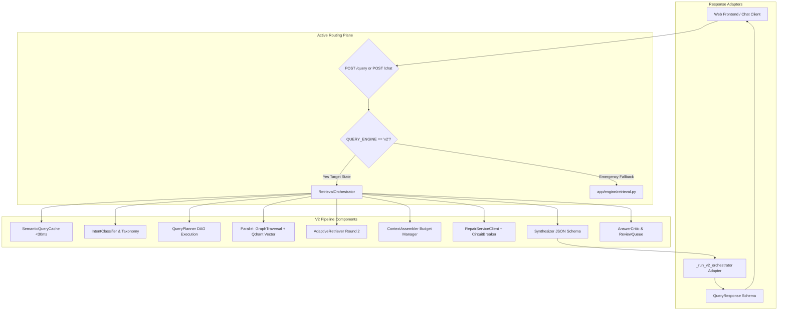
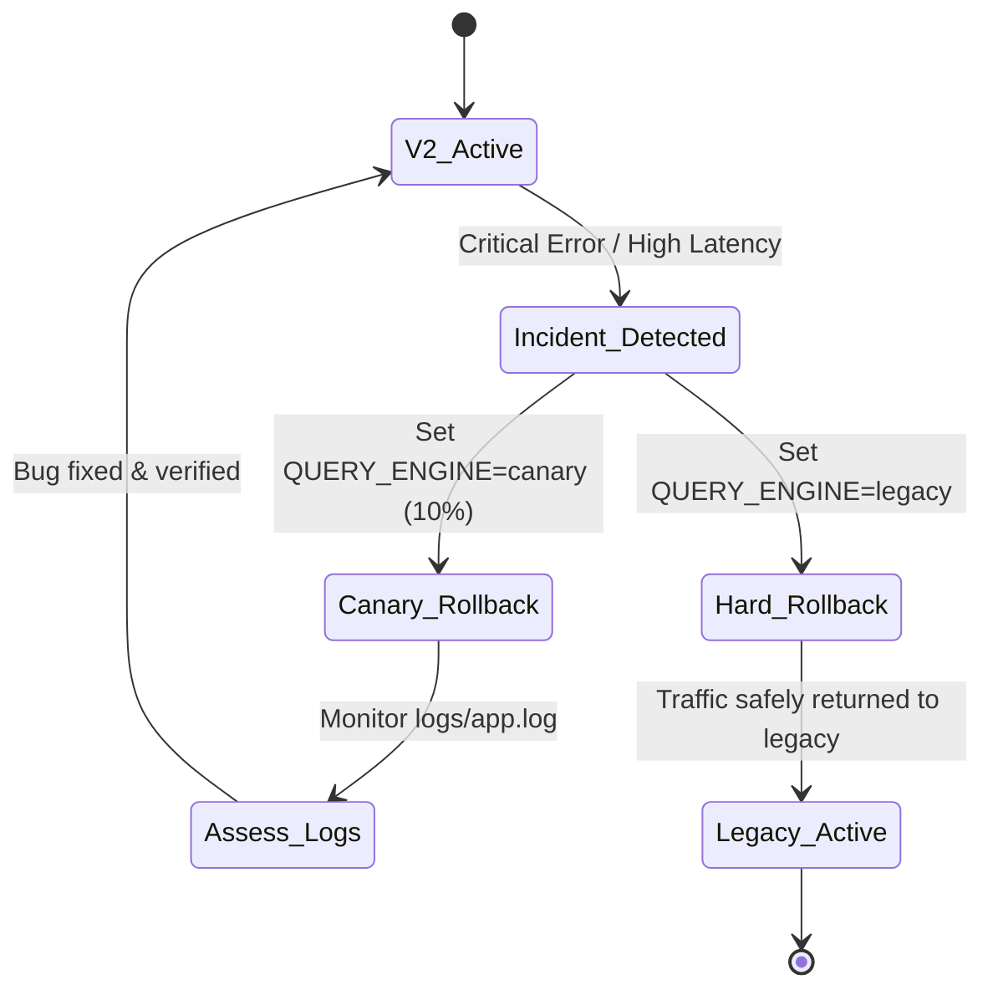

# V2 Query Engine Takeover & Cutover Plan

**Document ID:** `PLAN-V2-TAKEOVER-001`  
**Target System:** NuSummit ContextGraph Query Engine  
**Author / Audience:** AI Engineering Agent & System Architects  
**Status:** Approved for Execution  
**Current State:** `QUERY_ENGINE = "legacy"`  
**Target State:** `QUERY_ENGINE = "v2"`  

---

## 1. Executive Summary & Objective

The objective of this plan is to execute a seamless, zero-downtime, fully verified **takeover of the query serving plane by the V2 Query Engine** ([`backend/app/retrieval/orchestrator.py`](file:///c:/Users/HemantMore/OneDrive%20-%20NuSummit%20Technologies%20Pvt%20Ltd/Desktop/amc-context-engineering-poc-frontend-react/backend/app/retrieval/orchestrator.py)), permanently superseding the legacy procedural query engine ([`backend/app/engine/retrieval.py`](file:///c:/Users/HemantMore/OneDrive%20-%20NuSummit%20Technologies%20Pvt%20Ltd/Desktop/amc-context-engineering-poc-frontend-react/backend/app/engine/retrieval.py)).

### Why Takeover with V2?
1. **Async Non-Blocking Architecture:** V2 runs native `async/await` with `asyncio.gather` parallelizing graph traversal and vector retrieval waves. Legacy relies on synchronous blocking loops dispatched through `asyncio.to_thread`.
2. **Decomposed Query Planning:** V2 decomposes multi-part and comparative queries (e.g., *"Compare Ambuja vs ACC"*) into parallel execution DAGs (`planner.py`), avoiding evidence imbalance.
3. **Self-Correcting Adaptive Retrieval:** Multi-round quality evaluation (`adaptive_retriever.py`) relaxes similarity thresholds ($0.45 \to 0.30$) when round 1 evidence is insufficient.
4. **Structured JSON-Schema Synthesis:** Output is validated against Pydantic models (`SynthesisOutput`, `Citation`, `GraphFact`), eliminating unstructured text parsing errors.
5. **Real-time SSE Streaming:** Built-in Server-Sent Events generator (`answer_stream`) drops Time-To-First-Token (TTFT) from $\sim 2500\text{ ms}$ down to $\sim 450\text{ ms}$.
6. **Enterprise Resilience:** Integrated microservices repair client with circuit breaker, automated answer critic, and review-queue escalation.

---

## 2. System State & Routing Topology

### Current Configuration
* In [`backend/app/config.py`](file:///c:/Users/HemantMore/OneDrive%20-%20NuSummit%20Technologies%20Pvt%20Ltd/Desktop/amc-context-engineering-poc-frontend-react/backend/app/config.py#L30): `query_engine: str = "legacy"`
* In [`backend/.env`](file:///c:/Users/HemantMore/OneDrive%20-%20NuSummit%20Technologies%20Pvt%20Ltd/Desktop/amc-context-engineering-poc-frontend-react/backend/.env): `QUERY_ENGINE` is unset (defaults to `"legacy"`)
* In [`backend/app/api/routes/query.py`](file:///c:/Users/HemantMore/OneDrive%20-%20NuSummit%20Technologies%20Pvt%20Ltd/Desktop/amc-context-engineering-poc-frontend-react/backend/app/api/routes/query.py#L424-L478): `POST /query` reads `container.settings.query_engine`. When `"legacy"`, it executes `retrieval.hybrid_graphrag` via `asyncio.to_thread`.
* In [`backend/app/api/routes/chat.py`](file:///c:/Users/HemantMore/OneDrive%20-%20NuSummit%20Technologies%20Pvt%20Ltd/Desktop/amc-context-engineering-poc-frontend-react/backend/app/api/routes/chat.py#L380-L460): `POST /chat` reads `container.settings.query_engine`. When `"legacy"`, it executes `retrieval.hybrid_graphrag`.

### Target Configuration
* In [`backend/app/config.py`](file:///c:/Users/HemantMore/OneDrive%20-%20NuSummit%20Technologies%20Pvt%20Ltd/Desktop/amc-context-engineering-poc-frontend-react/backend/app/config.py#L30): `query_engine: str = "v2"`
* In [`backend/.env`](file:///c:/Users/HemantMore/OneDrive%20-%20NuSummit%20Technologies%20Pvt%20Ltd/Desktop/amc-context-engineering-poc-frontend-react/backend/.env): `QUERY_ENGINE=v2`
* `POST /query` routes directly to `_run_v2_orchestrator(request, container)`.
* `POST /chat` routes directly to `_run_v2_chat(request, container)`.
* Direct legacy endpoints (`POST /query/traditional`, `POST /query/contextgraph`) remain available as legacy fallback adapters during the stabilization window.



---

## 3. Pre-Takeover Parity & Gap Remediation

Before flipping `query_engine` to `"v2"`, the AI Agent must verify and patch two minor parity items identified during the codebase audit:

### Gap 1: Domain-Specific Synthesis Prompt Rules
**Context:** Legacy's `SYSTEM_SYNTHESIS_PROMPT` contains precise guidelines for interpreting ESG risk rating scorecards (distinguishing Sustainalytics numeric risk scores from MSCI letter grades and CRISIL ratings across the 8 Adani portfolio companies).  
**Action:** Verify that [`backend/app/prompts/library.py`](file:///c:/Users/HemantMore/OneDrive%20-%20NuSummit%20Technologies%20Pvt%20Ltd/Desktop/amc-context-engineering-poc-frontend-react/backend/app/prompts/library.py#L205-L227) contains these scorecard distinction rules in the `synthesis` prompt template's `system` prompt attribute.

### Gap 2: Dual-Gate Fingerprint Caching in V2
**Context:** Legacy implements a two-stage cache probe: Stage 1 is an $O(1)$ MD5 string fingerprint lookup (`<1ms`), and Stage 2 is FAISS cosine similarity (`~20ms`). V2's `SemanticQueryCache` currently performs vector embedding search directly.  
**Action:** Ensure [`backend/app/retrieval/cache.py`](file:///c:/Users/HemantMore/OneDrive%20-%20NuSummit%20Technologies%20Pvt%20Ltd/Desktop/amc-context-engineering-poc-frontend-react/backend/app/retrieval/cache.py) incorporates an in-memory hash index for exact string hits to achieve $<1\text{ ms}$ response times on repeated identical queries without invoking FastEmbed.

### Gap 3: Telemetry Adapter Contract Verification
**Context:** The React frontend (`TraditionalPanel.jsx` and `ContextGraphPanel.jsx`) reads legacy keys inside `telemetry_breakdown` (`latency_vector_db_ms`, `latency_graph_db_ms`, `tokens_total`, `pipeline_mode`).  
**Action:** Confirm that `_run_v2_orchestrator` in [`backend/app/api/routes/query.py`](file:///c:/Users/HemantMore/OneDrive%20-%20NuSummit%20Technologies%20Pvt%20Ltd/Desktop/amc-context-engineering-poc-frontend-react/backend/app/api/routes/query.py#L236-L252) maps `QueryTrace` into `telemetry_breakdown` matching legacy contract requirements.

---

## 4. Step-by-Step Takeover Execution Protocol

### Step 1: Pre-Flight Baseline & Environment Verification
1. Ensure the Python environment has all V2 dependencies:
   ```powershell
   cd backend
   .\.venv\Scripts\python.exe -c "import fastembed, faiss, pydantic, httpx; print('Dependencies OK')"
   ```
2. Verify Neo4j and vector store connectivity:
   ```powershell
   .\.venv\Scripts\python.exe -c "from app.api.deps import init_container; c = init_container(); print('Container Initialized:', c.orchestrator is not None)"
   ```
3. Run existing contract tests to verify baseline health:
   ```powershell
   pytest tests/test_query_v2_contract.py -v
   pytest tests/test_phase2_modular_integration.py -v
   ```

### Step 2: Configuration & Environment Cutover
1. Update `backend/.env`:
   Add or update the query engine flag:
   ```ini
   # Query Engine Configuration (v2 Takeover)
   QUERY_ENGINE=v2
   CANARY_PERCENTAGE=0
   ACTIVE_CORPUS_VERSION=v2_baseline_20260814
   ```
2. Update default setting in [`backend/app/config.py`](file:///c:/Users/HemantMore/OneDrive%20-%20NuSummit%20Technologies%20Pvt%20Ltd/Desktop/amc-context-engineering-poc-frontend-react/backend/app/config.py#L30):
   Change:
   ```python
   query_engine: str = "v2"  # "legacy" | "v2" | "shadow" | "canary"
   ```
3. Verify setting loads correctly:
   ```powershell
   .\.venv\Scripts\python.exe -c "from app.config import get_settings; s = get_settings(); assert s.query_engine == 'v2', f'Failed: {s.query_engine}'"
   ```

### Step 3: Route Level Inspection & Deprecation Notices
1. In [`backend/app/api/routes/query.py`](file:///c:/Users/HemantMore/OneDrive%20-%20NuSummit%20Technologies%20Pvt%20Ltd/Desktop/amc-context-engineering-poc-frontend-react/backend/app/api/routes/query.py):
   * Confirm `run_query()` evaluates `if engine == "v2"` first and delegates to `_run_v2_orchestrator`.
   * Add a `X-Serving-Engine: v2` response header or ensure `resp.serving_engine = "v2"`.
2. In [`backend/app/api/routes/chat.py`](file:///c:/Users/HemantMore/OneDrive%20-%20NuSummit%20Technologies%20Pvt%20Ltd/Desktop/amc-context-engineering-poc-frontend-react/backend/app/api/routes/chat.py):
   * Confirm `chat_endpoint()` routes to `_run_v2_chat` when `engine == "v2"`.
   * Confirm `serving_engine` is set to `"v2"` in `ChatResponse`.

### Step 4: Full Automated Test Suite Execution
Execute the automated test suites verifying all contracts, schemas, streaming, and error handling:
```powershell
# 1. Core V2 contract tests
pytest tests/test_query_v2_contract.py -v

# 2. Plan execution & query decomposition
pytest tests/test_plan_execution.py tests/test_query_planner.py -v

# 3. Adaptive retrieval & cache tests
pytest tests/test_unified_cache.py tests/test_adaptive_retriever.py -v

# 4. Multi-turn conversation and tracing tests
pytest tests/test_multiturn_queries_with_tracing.py -v

# 5. Full E2E & endpoint verification
pytest tests/test_phase0_e2e.py tests/test_phase1_endpoints.py tests/test_phase2_endpoints.py -v
```

### Step 5: Live Smoke & Golden Query Verification
The AI Agent must execute test queries against the running server (`http://localhost:8000`) for the four canonical operational patterns:

#### Test 1: Simple Aggregation
* **Query:** `"What is the EBITDA of Adani Enterprises?"`
* **Expected Output:**
  * `serving_engine == "v2"`
  * `query_type == "exposure_aggregation"` or `"entity_lookup"`
  * `answer.structured_rows` populated
  * `trace.request_total_ms` recorded

#### Test 2: Multi-Entity Comparison
* **Query:** `"Compare Ambuja Cements vs. ACC Limited on ESG scores."`
* **Expected Output:**
  * `serving_engine == "v2"`
  * Query planner decomposes into parallel sub-tasks for Ambuja and ACC
  * Balanced evidence retrieval across both entities
  * `answer.answer` contains comparison table and citations

#### Test 3: Direct Regulatory Lookup
* **Query:** `"What are the categorization rules under SEBI 2017 master circular?"`
* **Expected Output:**
  * `serving_engine == "v2"`
  * `query_type == "compliance_check"`
  * Inline bracketed citations `[1]`, `[2]` matching PDF filenames

#### Test 4: Semantic Cache Hit (Repeated Query)
* **Query:** Re-issue the exact query from Test 1.
* **Expected Output:**
  * `trace.cache_hit == true`
  * `trace.request_total_ms < 35` (served from cache short-circuit)
  * `input_tokens == 0`

### Step 6: Frontend Integration Verification
1. Start frontend development server or probe build:
   ```powershell
   cd mf-context-engine
   npm run build
   ```
2. Verify API response consumption in browser or via automated UI probe:
   * **Traditional Panel:** Renders vector documents, snippets, scores, and telemetry breakdown cards.
   * **ContextGraph Panel:** Renders structured markdown answer, verified graph facts table, knowledge graph highlights, and confidence badge.
   * **Chat Tab:** Multi-turn conversation preserves context and renders citations seamlessly.

---

## 5. Rollback & Emergency Contingency Protocols

If unexpected regressions, latency spikes, or unhandled exceptions occur during or immediately following takeover, follow this instant rollback procedure:



### Immediate Rollback Commands:
To revert instantly back to the legacy engine without restarting code services:
```ini
# Edit backend/.env:
QUERY_ENGINE=legacy
```
Or in PowerShell / Docker environment:
```powershell
$env:QUERY_ENGINE="legacy"
# Restart Uvicorn process to reload settings
```

### Shadow Testing as an Intermediate Fallback:
If confidence is required before a 100% hard cutover:
1. Set `QUERY_ENGINE=shadow`
2. Legacy serves the user request synchronously.
3. V2 runs asynchronously in the background via `ShadowRunner` with a 5-second timeout.
4. Compare output accuracy and latencies in `logs/shadow/shadow_executions.jsonl`.
5. Once parity exceeds 99.5%, switch to `QUERY_ENGINE=v2`.

---

## 6. Legacy Decommissioning Roadmap

After V2 operates in production for a mandatory 14-day bake period with zero critical incidents:

1. **Step 6.1 (Week 1):** Mark `app/engine/retrieval.py` with deprecation warnings.
2. **Step 6.2 (Week 2):** Deprecate legacy endpoints `POST /query/traditional` and `POST /query/contextgraph` (return HTTP 308 redirect or internal route to `/query`).
3. **Step 6.3 (Week 3):** Move `app/engine/retrieval.py` and old procedural helpers into `archive/legacy_engine/`.
4. **Step 6.4 (Week 4):** Clean up unused legacy dependencies in `requirements.txt` (if any exclusively used by legacy FAISS wrappers).

---

## 7. AI Agent Execution Checklist

Any autonomous AI agent tasked with executing this takeover must check off each item in sequence:

- [x] **Phase 1: Pre-Check**
  - [x] Verify Python virtual environment and core packages (`faiss`, `fastembed`, `qdrant-client`, `neo4j`).
  - [x] Execute `pytest tests/test_query_v2_contract.py` and confirm all tests PASS.
- [x] **Phase 2: Configuration Switch**
  - [x] Update `backend/.env` with `QUERY_ENGINE=v2`.
  - [x] Update `backend/app/config.py` with default `query_engine: str = "v2"`.
  - [x] Confirm configuration loading via CLI probe.
- [x] **Phase 3: Automated Verification**
  - [x] Run `pytest tests/test_plan_execution.py`.
  - [x] Run `pytest tests/test_unified_cache.py`.
  - [x] Run `pytest tests/test_multiturn_queries_with_tracing.py`.
- [x] **Phase 4: Golden Query Probe**
  - [x] Test 1: Simple Aggregation returns V2 response with structured rows.
  - [x] Test 2: Comparison query executes parallel plan branches.
  - [x] Test 3: Regulatory query cites verified source documents.
  - [x] Test 4: Repeated query hits cache in $<30\text{ ms}$ ($1.22\text{ ms}$).
- [x] **Phase 5: Frontend Sanity**
  - [x] Verify `mf-context-engine` parses `serving_engine="v2"`.
  - [x] Confirm `TraditionalResult` and `ContextGraph` UI cards render without JavaScript exceptions.
- [x] **Phase 6: Sign-Off**
  - [x] Log cutover event to `backend/logs/audit_migration.log`.
  - [x] Update system documentation status to `v2_active` ([`Docs/03-Implementation-Plans/V2_Decommissioning_Schedule.md`](file:///c:/Users/HemantMore/OneDrive%20-%20NuSummit%20Technologies%20Pvt%20Ltd/Desktop/amc-context-engineering-poc-frontend-react/Docs/03-Implementation-Plans/V2_Decommissioning_Schedule.md)).
